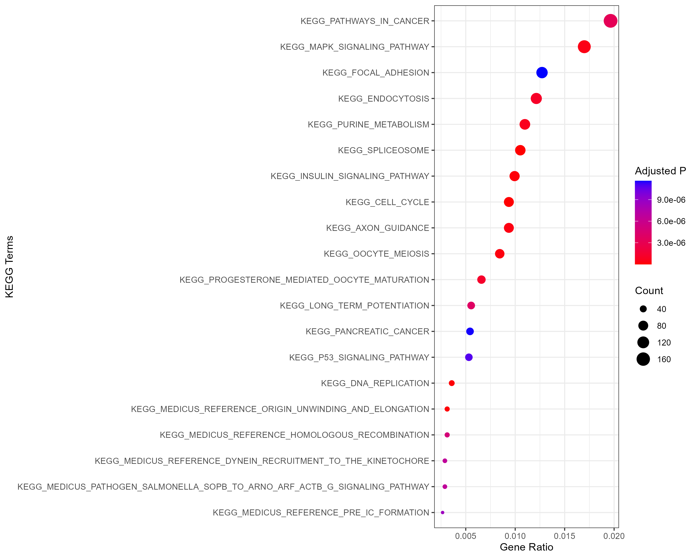

# Medulloblastoma Microarray Analysis

**A reproducible bioinformatics workflow for microarray gene expression analysis of medulloblastoma using R and Bioconductor.**

---

## Overview

This project presents a computational workflow for analyzing gene expression data in medulloblastoma using the publicly available GEO dataset **GSE124814**.

The analysis was conducted in R using Bioconductor packages and includes data exploration, quality control, gene annotation, differential gene expression analysis, data visualization, and functional enrichment analysis.

The primary objective is to identify differentially expressed genes (DEGs) and investigate their associated biological processes and signaling pathways.

This project was developed for educational and research purposes, with an emphasis on reproducible bioinformatics analysis.

---

## Dataset

| Feature | Description |
|---|---|
| Database | NCBI Gene Expression Omnibus (GEO) |
| GEO Accession | GSE124814 |
| Platform | Affymetrix Microarray |
| Organism | Homo sapiens |
| Disease | Medulloblastoma |
| Data Type | Gene Expression |

**Data preprocessing note:**

The expression matrix obtained from GEO had already undergone preprocessing by the original study, including background correction, normalization, cross-platform integration, and batch-effect correction.

Therefore, the downstream analysis focused on data exploration, quality assessment, gene annotation, differential expression, and functional enrichment.

Dataset: [GSE124814 – NCBI GEO](https://www.ncbi.nlm.nih.gov/geo/query/acc.cgi?acc=GSE124814)

---

## Analysis Workflow

The project follows these main analytical steps:

1. Dataset retrieval using GEOquery
2. Exploratory data analysis
3. Primary quality control (QC)
4. Data preprocessing and gene annotation
5. Differential gene expression analysis using limma
6. Volcano plot visualization
7. Heatmap generation
8. Gene Ontology (GO) enrichment analysis
9. KEGG pathway enrichment analysis

---

## Repository Structure

```text
Medulloblastoma-Microarray-Analysis/
│
├── data/
│   └── README.md
│
├── scripts/
│   ├── 01_Download_GSE_Dataset.R
│   ├── 02_Primary_QC.R
│   ├── 03_Preprocessing.R
│   ├── 04_DEG_Limma.R
│   ├── 05_Visualization.R
│   └── 06_Enrichment_Analysis.R
│
├── results/
│   ├── figures/
│   └── tables/
│
├── docs/
│   └── README.md
│
├── README.md
└── .gitignore
```

---

## Differential Gene Expression Analysis

Differential gene expression analysis was performed using the **limma** package.

The analysis identified several genes with statistically significant expression differences between the selected biological groups.

### Representative DEG Results

The following table presents selected genes from the differential expression analysis.

| Gene | logFC | t-statistic | Adjusted P-value | Regulation |
|---|---:|---:|---:|---|
| ITPR1 | -1.1525 | -21.77 | 1.26e-88 | Down |
| TOP2A | 1.5176 | 21.47 | 7.95e-87 | Up |
| PCLAF | 1.1441 | 20.56 | 2.09e-80 | Up |
| CENPF | 1.1216 | 18.46 | 1.68e-66 | Up |
| NCAPG | 1.0832 | 18.30 | 2.07e-65 | Up |
| RYR2 | -1.0414 | -17.70 | 1.22e-61 | Down |
| SLC12A5 | -1.1054 | -17.09 | 6.93e-58 | Down |
| NUSAP1 | 1.0785 | 16.65 | 2.92e-55 | Up |
| GABRA6 | -1.6320 | -15.83 | 2.10e-50 | Down |
| CD24 | 1.0675 | 13.85 | 1.52e-39 | Up |

*Note: These are selected representative results, not the complete DEG list. Regulation labels reflect the sign of logFC under the contrast defined in the analysis.*

### Key Observations

- TOP2A, PCLAF, CENPF, and NCAPG showed positive log-fold changes.
- ITPR1, RYR2, SLC12A5, and GABRA6 showed negative log-fold changes.
- The selected genes demonstrated highly significant adjusted p-values.

---

## Visualization

The results of the analysis are visualized using several graphical approaches.

### Volcano Plot



### Functional Enrichment


*Note: Replace the image paths above with the exact filenames available in the results/figures directory. PNG images are recommended for embedding in GitHub README files.*

---

## Functional Enrichment Analysis

Functional enrichment analysis was performed using **clusterProfiler** to investigate the biological significance of differentially expressed genes.

The analysis included:

- Gene Ontology (GO) enrichment analysis
- KEGG pathway enrichment analysis

These analyses provide insights into biological processes and signaling pathways associated with the identified gene expression changes.

---

## Tools and Technologies

| Category | Tools |
|---|---|
| Programming Language | R |
| Data Retrieval | GEOquery |
| Data Manipulation | tidyverse |
| Differential Expression | limma |
| Gene Annotation | AnnotationDbi, org.Hs.eg.db |
| Enrichment Analysis | clusterProfiler, enrichplot |
| Visualization | ggplot2 |

---

## Future Directions

Potential extensions of this project include:

- Machine learning-based biomarker identification
- Validation using independent GEO datasets
- Protein-protein interaction network analysis
- Survival analysis and clinical outcome prediction
- Integration of additional omics datasets

---

## Reproducibility

The analysis scripts are organized sequentially in the `scripts/` directory.

To reproduce the workflow:

1. Clone this repository.
2. Install the required R and Bioconductor packages.
3. Follow the scripts in numerical order.
4. Refer to the `data/` directory for dataset information.

---

## Author

**Sina Moradizadeh**

B.Sc. in Cell and Molecular Biology | M.Sc. Student in Genetics

**Research Interests:** Bioinformatics, Computational Genomics, Cancer Genomics, and Machine Learning in Biomedical Research.
